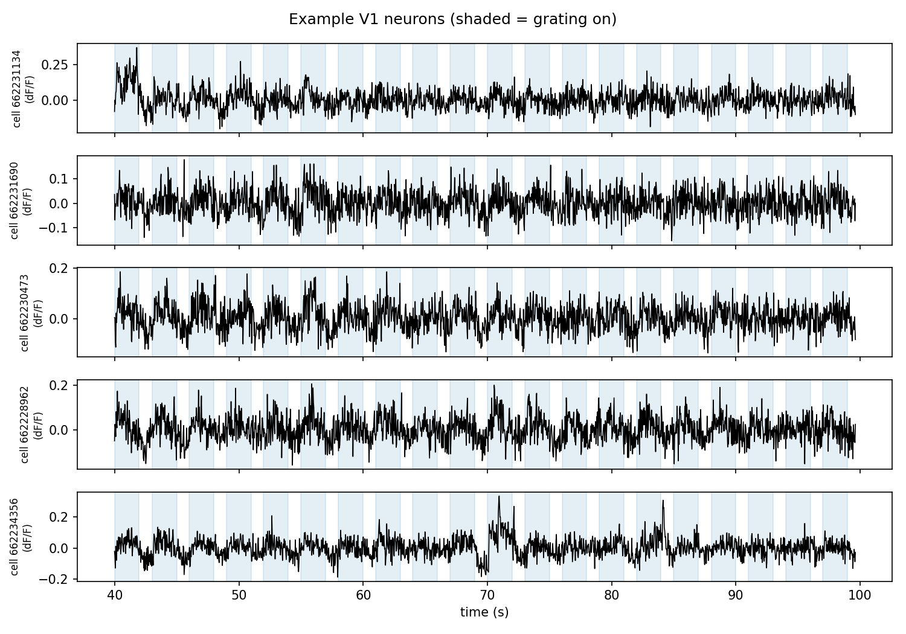
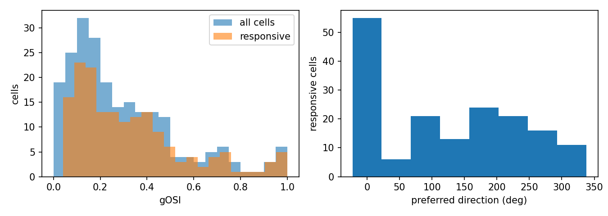
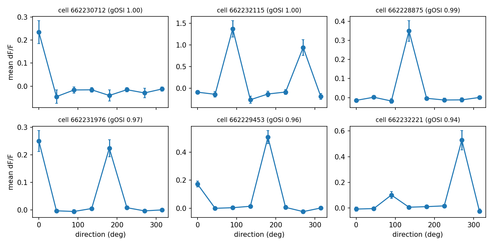
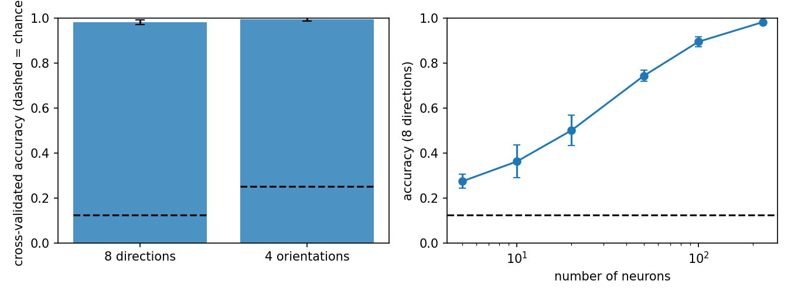

# Decoding grating direction from mouse V1 population activity

Orientation tuning and population decoding on one two-photon calcium-imaging
session from the Allen Brain Observatory (Visual Coding), using Python and the
`allensdk` package.

**Main result:** from the activity of 226 simultaneously recorded V1 neurons, a
regularised logistic-regression decoder recovers the direction of a drifting
grating (8 directions) with **98% cross-validated accuracy** (chance 12.5%),
although the median single-neuron orientation selectivity is low (gOSI ≈ 0.22).

## Question

How selective are individual V1 neurons for grating direction, and how well can
the direction of the stimulus be read out from the population?

## Data

- Allen Brain Observatory, Visual Coding 2-photon dataset
- Experiment `645413759` (container `645413757`), session type `three_session_A`
- Area VISp, Cux2-CreERT2 line, GCaMP6f, imaging depth 275 µm
- 226 neurons, 115,760 frames at ~30 Hz
- Drifting-gratings epoch: 628 presentations (598 gratings + 30 blank sweeps),
  8 directions (0°–315°, 45° steps) × 5 temporal frequencies (1, 2, 4, 8, 15 Hz),
  about 75 presentations per direction (each grating lasts 60 frames ≈ 2 s,
  followed by ~1 s of gray screen)
- Signal used: the dF/F traces provided by the Allen pipeline



*dF/F of five randomly chosen neurons during the first 60 s of the
drifting-gratings epoch (shaded = grating on). Single-trial responses of typical
neurons are small relative to the noise, which is why responses are averaged
over trials for tuning and combined across neurons for decoding.*

## Methods

**Trial responses.** For each presentation and each neuron: mean dF/F during the
grating minus mean dF/F in the 15 frames (~0.5 s) before onset. The pre-stimulus
window falls in the gray period, so it serves as a baseline and removes slow
drifts. Result: a (trials × neurons) matrix.

**Tuning.** Mean response per direction (pooled over temporal frequencies).
Selectivity is summarised by the global orientation selectivity index

```
gOSI = | sum_k R_k * exp(2i * theta_k) | / sum_k R_k      (R_k clipped at >= 0)
```

where `R_k` is the mean response to direction `theta_k`. The factor 2 treats
θ and θ + 180° as the same orientation. gOSI is 0 for a flat tuning curve and 1
for a response to a single orientation (or to a single direction: it does not
distinguish the two). A neuron is called *responsive* if a one-way ANOVA across
the 8 directions gives p < 0.01 (uncorrected for multiple comparisons).

**Decoding.** Standardisation (z-score per neuron) followed by multinomial
logistic regression (L2, `C = 0.05`), as one scikit-learn pipeline so that the
scaler is fit on training folds only. Evaluation with stratified 5-fold
cross-validation over trials (shuffled, seed 0). Reported accuracy is the mean
over folds, ± is the standard deviation over folds.
- *Null distribution:* the whole cross-validation is repeated 200 times with
  shuffled direction labels.
- *Orientation decoding:* the same decoder with labels `direction mod 180`
  (4 classes), which ignores the direction of motion.
- *Accuracy vs. population size:* random subsets of neurons (5 repeats per size).

## Results

| Metric | Value |
|---|---|
| Neurons | 226 |
| Responsive neurons (ANOVA p < 0.01) | 74% (167 / 226) |
| Median gOSI, all neurons | 0.22 |
| Median gOSI, responsive neurons | 0.27 |
| Decoding accuracy, 8 directions | 98.2% ± 1.0% (chance 12.5%) |
| Accuracy with shuffled labels (200 shuffles) | ≈ 13%; none reached the true accuracy (p ≤ 0.005) |
| Decoding accuracy, 4 orientations | 99.3% ± 0.8% (chance 25%) |

Accuracy (8 directions) as a function of the number of neurons:

| Neurons | 5 | 10 | 20 | 50 | 100 | 226 |
|---|---|---|---|---|---|---|
| Accuracy | 27% | 36% | 50% | 74% | 89% | 98% |

**Single-neuron tuning.** gOSI is right-skewed: most neurons have low values,
with a tail of highly selective cells. The most selective neurons include
both single-peaked (direction-selective) and two-peaked (orientation-selective)
tuning curves.



*Left: gOSI of all neurons and of responsive neurons. Right: preferred direction
(direction of the largest mean response) of responsive neurons.*



*Mean ± SEM dF/F per direction for the six responsive neurons with the highest gOSI.*

**Preferred directions are not uniform.** 55 of the 167 responsive neurons (33%)
prefer 0°, whereas about 21 (12.5%) would be expected if all 8 directions were
equally represented (counts read from the histogram: 0°: 55, 45°: 6, 90°: 21,
135°: 13, 180°: 24, 225°: 21, 270°: 16, 315°: 11). Whether this reflects a real
anisotropy of this animal / field of view, or an artifact (for example slow
signal drift correlated with presentation order), has not been investigated.



*Left: cross-validated accuracy (error bars: SD over 5 folds; dashed lines:
chance, 12.5% for 8 directions and 25% for 4 orientations). Right: 8-direction
accuracy versus the number of randomly drawn neurons (error bars: SD over 5
random subsets; the last point uses all neurons and therefore has no spread).*

Raw numbers are in `figs/results.json`.

## Discussion

**Why is single-neuron selectivity low while the population decodes direction
almost perfectly?**

1. *gOSI is a one-number summary of one neuron.* A neuron whose response is
   modest but depends reliably on direction gets a low gOSI and still carries
   information. gOSI is also not exactly zero for an untuned neuron (noise and
   clipping at zero), so part of the median of 0.22 is a noise floor; the
   histogram shows many neurons below 0.2. The decoder instead learns a weight
   per neuron from single-trial responses and combines all of them.
2. *Information adds up across a heterogeneous population.* Different neurons
   prefer different directions, so each direction evokes a distinct pattern
   across the population. Accuracy grows steadily with population size, from 27%
   with 5 neurons to 98% with all 226, and has not saturated: no small subset of
   highly selective cells is required.
3. *gOSI and the decoder measure different things.* gOSI treats θ and θ + 180°
   as the same orientation, while the decoder is trained on direction. Accuracy
   is almost the same for 8 directions (98%) and 4 orientations (99%), so
   opposite directions are rarely confused. This suggests that the population
   carries direction information (not directly tested, e.g. with a direction
   selectivity index). Consistent with this, the top-gOSI neurons include
   single-peaked cells (e.g. cell 662230712 responds essentially only to 0°) and
   two-peaked cells (e.g. cell 662232115, peaks at 90° and 270°); both have
   gOSI ≈ 1, so gOSI cannot tell them apart.

## Limitations

- One experiment from one mouse; nothing here shows the result generalises
  across animals, layers or Cre lines.
- Cross-validation splits trials at random. Trials close in time are not fully
  independent (slow fluctuations, drift), so the accuracy may be somewhat
  optimistic; a blocked, time-ordered split would be a stricter test.
- The strong over-representation of 0° among preferred directions is unexplained
  (see Results).
- The regularisation strength (`C = 0.05`) was fixed in advance, not tuned.
- Responses are pooled over the five temporal frequencies; effects of temporal
  frequency, and generalisation across it, are not analysed.
- gOSI does not capture direction selectivity, and direction selectivity itself
  was not quantified.
- The ANOVA responsiveness criterion has no multiple-comparison correction
  (roughly 2 false positives are expected among 226 neurons at p < 0.01).
- Baseline and response windows are simple choices; neuropil contamination and
  the quality of the Allen dF/F extraction were not examined.
- The accuracy-vs-neurons curve has not saturated at 226 neurons, so it does not
  tell how many neurons are needed in total.

## Reproduce

Tested with Python 3.9 on Windows.

```
python -m venv venv
venv\Scripts\python.exe -m pip install --upgrade pip
venv\Scripts\python.exe -m pip install -r requirements.txt
venv\Scripts\python.exe week1_explore.py     # downloads the experiment into boc/, first plots
venv\Scripts\python.exe run_analysis.py      # tuning + decoding, writes figs/
```

Notes:
- On Windows, installing `allensdk` into a deeply nested path (e.g. a
  Microsoft-Store Python profile folder) can fail because of the 260-character
  path limit; create the virtual environment in a short path such as `C:\v`.
- If `pip` tries to build `greenlet` from source, add `--only-binary=greenlet`.
- `run_analysis.py` uses the experiment id set in `EXP_ID`; `N_SHUFFLES` controls
  the number of label shuffles.

## Repository layout

| File | Purpose |
|---|---|
| `week1_explore.py` | Download one experiment, inspect the data, first plots |
| `analysis.py` | Trial responses, tuning, gOSI, ANOVA, decoding functions (self-test: `python analysis.py`) |
| `run_analysis.py` | Runs the full analysis and writes `figs/` |
| `figs/` | Figures and `results.json` |

## Data source

Data from the Allen Brain Observatory (Allen Institute for Brain Science),
accessed through the `allensdk` package. Please follow the Allen Institute's
terms of use and citation policy (see the Allen Brain Observatory website).
